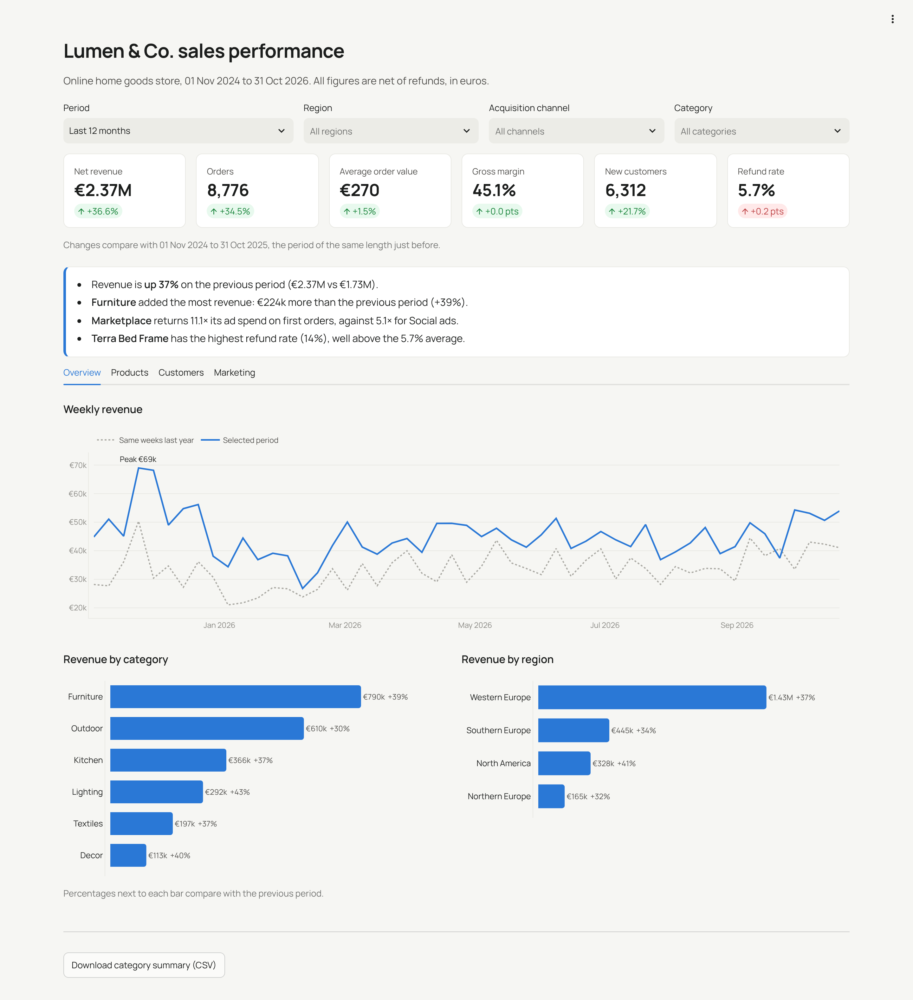
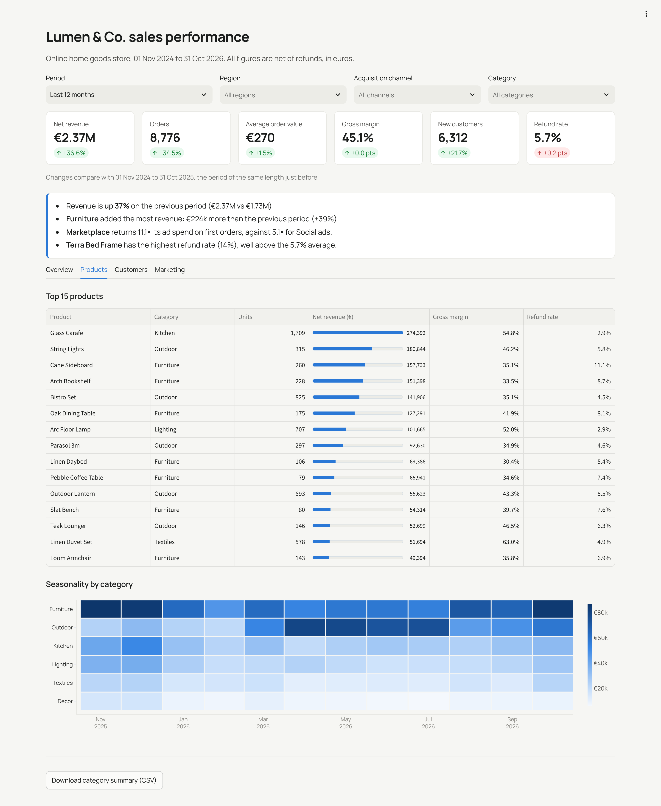
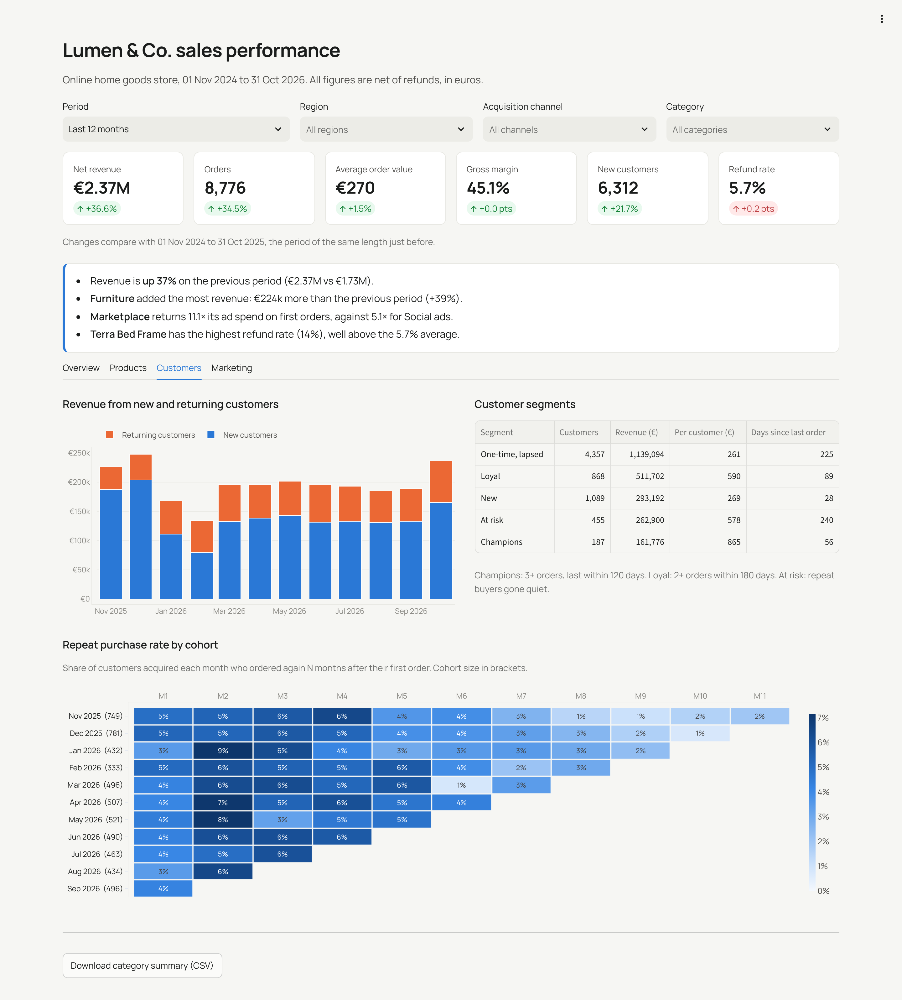
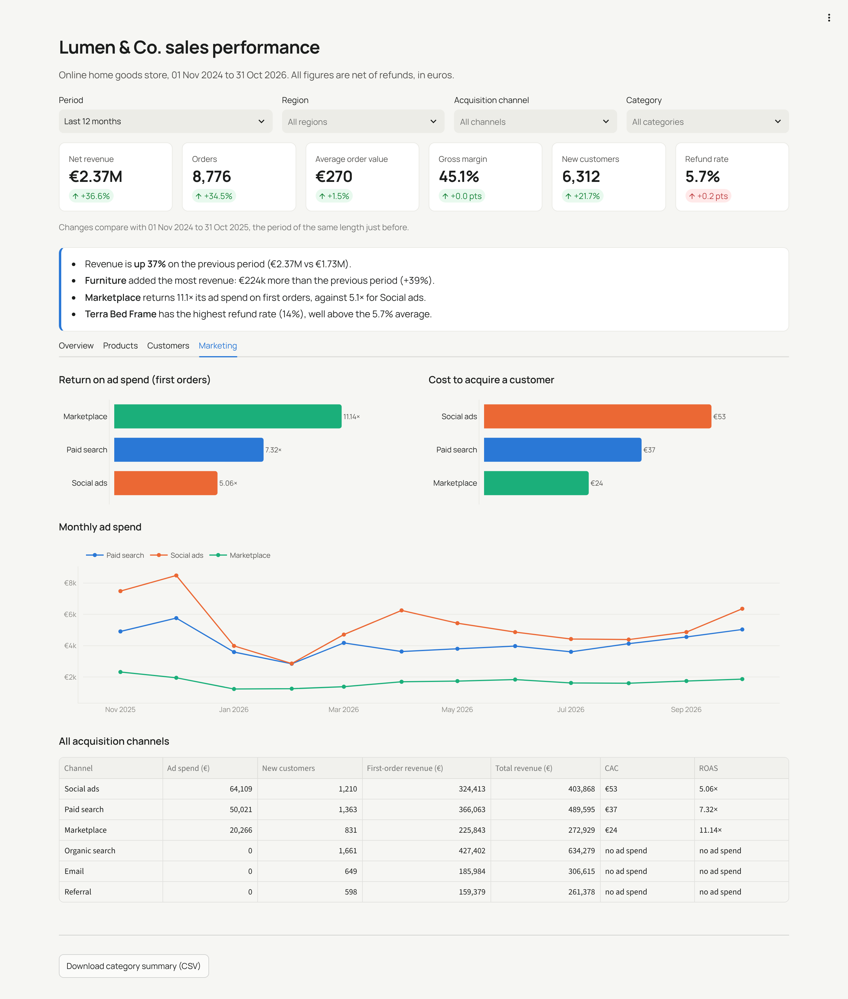

# Sales performance dashboard (BI)

[](https://github.com/hamidomail/sales-bi-dashboard/actions/workflows/tests.yml)

An end-to-end **business intelligence** project for a fictional online home goods store: raw data, a SQL star schema in **DuckDB**, automated data quality checks, and an interactive **Streamlit + Plotly** dashboard that answers the questions a founder or head of e-commerce asks every Monday.



## Questions it answers

| Tab | Questions |
|---|---|
| **Overview** | How much did we sell, is it growing, and versus last year? Which categories and regions drive it? |
| **Products** | What are the best sellers, their margin and refund rate? How does each category's season look? |
| **Customers** | How much revenue comes from returning customers? Which cohorts come back, and when? Who are our champions and who is at risk? |
| **Marketing** | Which paid channel returns the most per euro (ROAS)? What does a new customer cost (CAC)? |

Every number responds to the filters (period presets or custom dates, region, acquisition channel, category). KPI tiles compare with the previous period of the same length, and an **insights panel** writes the headline findings in plain language: what grew, what drove it, which channel performs best, which product is being returned too often.

## Pipeline

```
data/raw/*.csv  ──►  sql/01_staging.sql  ──►  sql/02_marts.sql  ──►  data/warehouse.duckdb  ──►  Streamlit app
 (generator)          typed staging            star schema +             (single file,               (parameterised
                                               data quality checks        no server)                 SQL queries)
```

**Star schema**: `fct_sales` (order lines, net of refunds) and `fct_marketing` (daily ad spend), with `dim_customer` (including acquisition cohort), `dim_product` and `dim_date`. The build **fails** if a quality check finds orphan rows, negative quantities, duplicate order IDs or suspicious prices.

The same model exports to **Power BI, Tableau or Looker Studio**: `python scripts/export_star_schema.py` writes every table as CSV and Parquet.

## Quick start

```bash
python -m venv .venv && source .venv/bin/activate     # Windows: .venv\Scripts\activate
pip install -r requirements.txt
python scripts/generate_data.py      # 24 months: ~11.5k customers, ~15k orders, ~25k order lines
python scripts/build_warehouse.py    # builds data/warehouse.duckdb and runs quality checks
streamlit run app.py
```

Open http://localhost:8501.  **Docker:** `docker build -t sales-dashboard . && docker run -p 8501:8501 sales-dashboard`

## Using real data

Replace the generator with an extract from the client's systems (Shopify, WooCommerce, Stripe, a SQL database, Google Ads and Meta exports) that writes the same five CSV files, or point `sql/01_staging.sql` at the source directly (DuckDB reads Postgres, MySQL, Parquet, S3 and Excel). The dashboard and marts do not change.

## Metric definitions

| Metric | Definition |
|---|---|
| Net revenue | Sum of order line amounts after discounts, excluding refunded lines |
| Gross margin | (Net revenue − cost of goods) ÷ net revenue |
| AOV | Net revenue ÷ distinct orders |
| Refund rate | Refunded amount ÷ gross revenue |
| CAC | Ad spend ÷ new customers acquired by that channel |
| ROAS (first orders) | First-order revenue of customers acquired by a channel ÷ its ad spend |
| Repeat purchase rate | Share of a monthly cohort that ordered again N months after their first order |

## Tests

```bash
pip install -r requirements-dev.txt
pytest -q   # breakdowns add up to KPIs, filters, period logic, channel economics, and the app renders for every preset
```

## More screenshots

| Products | Customers | Marketing |
|---|---|---|
|  |  |  |

The dataset is synthetic, generated with built-in patterns (year-over-year growth, Black Friday and December peaks, summer Outdoor season, channel-dependent loyalty, higher Furniture refunds) so the dashboard has real stories to show.
